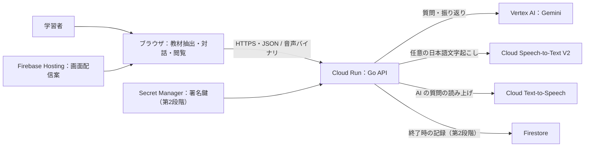
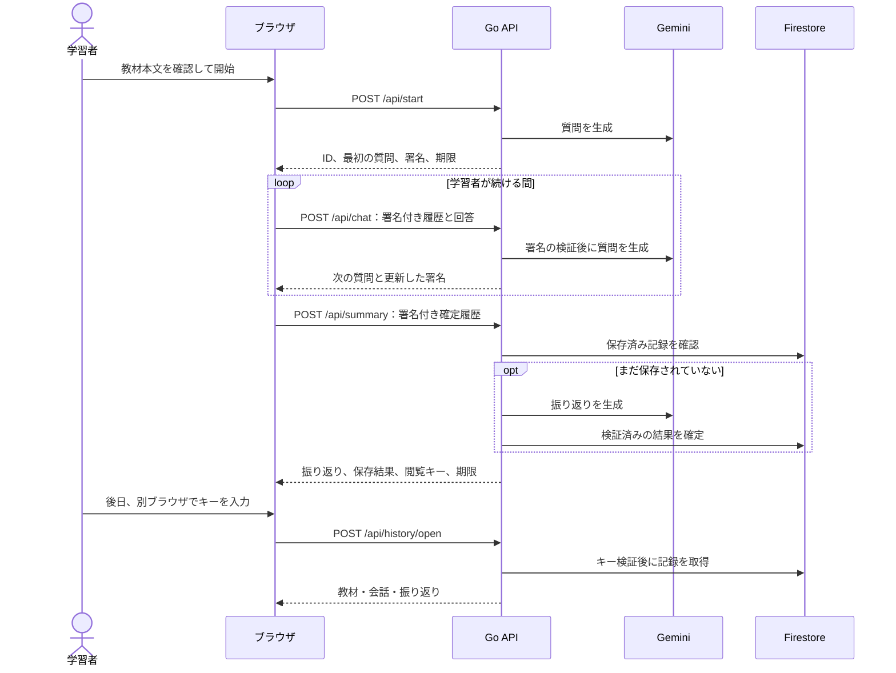

# アーキテクチャ全体図

## システム構成

- 第1段階は Firestore と Secret Manager を使わず、振り返りを返すだけ。保存・署名・閲覧キーは第2段階で足す。
- 音声入力は任意の追加機能。録音音声は `/api/speech/transcribe` で検証して文字起こしし、利用者が確認した後に既存の `/api/chat` へテキストで送る。音声を Gemini へ渡さず、DBやオブジェクトストレージにも保存しない。
- AI の質問の読み上げも任意の追加機能。`/api/start`・`/api/chat` の質問を表示した後、`/api/speech/synthesize` が返す MP3 をブラウザで再生する。音声化に失敗しても文字で対話を続けられる。
- 学習中はブラウザのメモリに本文・履歴・署名を保持する。Go は内容を検証し、学習データを保存せずに質問と新しい署名を返す。
- 終了時に Go が振り返りを生成・検証し、教材本文、確定履歴、振り返りを Firestore に保存する。キーを返すのは確定後。
- Firestore は Go のみが利用する。閲覧キーの再入力で1件を開く。未完了の学習（教材・確定会話・署名・回答下書き・自己確認・凍結状態）と開始前の教材下書きだけは、最長2時間の固定期限付き localStorage で保持する。保存成功・明示破棄・期限切れで取り除き、保存済み結果・閲覧キー・音声は永続化しない。

## 学習と再閲覧

`/api/summary` を再送しても、同じ記録に対して同じ結果とキーを返す。削除の確定・再送・期限の扱いは [データ設計](DATABASE_DESIGN.md) に従う。

## 実行と公開

ローカルでは画面と Go API を分けて起動する。審査用は Firebase Hosting の画面から Cloud Run へ HTTPS で直接接続する。アプリ独自の利用枠は作らず、入力上限・最大インスタンス数・予算アラートで抑える（[技術要件](TRD.md#公開-api-の守り)）。GitHub の push、Firestore の設定、Cloud Run・Web の配信は別の操作。 [開発ルール](DEVELOPMENT_RULES.md)
