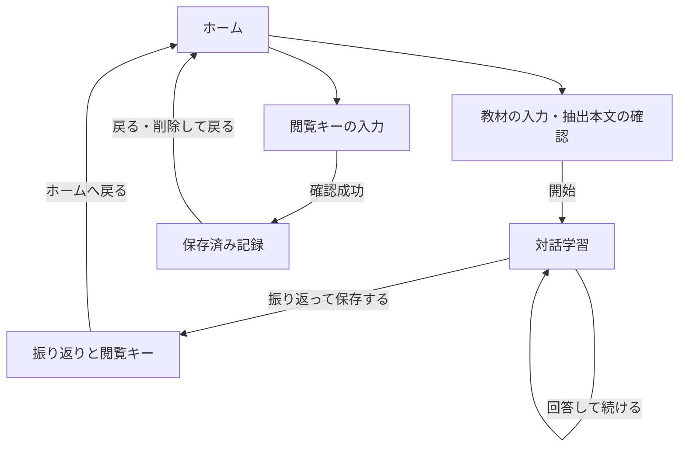

# 機能要件

## MVP の画面遷移

| ID | 機能 | 段階 | 関連 API |
| --- | --- | --- | --- |
| F-01 | ホームから開始または再閲覧へ進む | 1（再閲覧の入口は2） | — |
| F-02 | 教材本文を確認して学習を開始する | 1 | `POST /api/start` |
| F-03 | 説明を入力して対話を続ける | 1（残り時間の表示は2） | `POST /api/chat` |
| F-04 | 振り返りを生成し、終了時に保存する | 1（保存と閲覧キーは2） | `POST /api/summary` |
| F-05 | 閲覧キーで記録を開く・削除する | 2（削除は3） | `POST /api/history/open`、`POST /api/history/delete` |

段階は [PRD](PRD.md#mvp-の範囲と段階) を参照。図の「閲覧キーの入力」と「保存済み記録」は第2段階から。

## Figma と MVP の対応

第1段階の画面の流れは [MVP(OpusDesign) の正常動線](https://www.figma.com/file/XLXYmrHRrHDjEuF5kM9gug?node-id=68-188) の8フレームを参照する。見た目は Material Design 3（上部バーと進み具合の線、セグメントボタン、入力欄、確認ダイアログ、ライト・ダーク両対応）に揃え、画面の文言は操作と必要な注意だけにする。配置は Material Design 3 の画面幅の区分に合わせ、スマートフォン・タブレット・PC で読みやすい幅にする。幅 840px 以上では振り返りのカードを2列に並べ、さらに高さが 521px 以上あればホームと教材入力も2列にする。高さの低い横画面では1列のままにし、主ボタンを画面内に残す。iPhone の切り欠きやホームバーにボタンが重ならないようにする。ホームの閲覧キー案内は第2段階の予告として表示する。

| 画面・部品 | 今回動かす範囲 | 後に回す範囲 |
| --- | --- | --- |
| ホーム・学習カード | 「学習をはじめる」を有効にする。閲覧キーは第2段階の案内を表示 | アカウント別の学習カード一覧・草のカレンダー |
| 教材入力 | 直接入力、ファイル選択、本文の確認・修正、エラー | ISBN・ロードマップ・OCR |
| 対話・ゼロ | 質問、回答欄、送信状態、任意の音声録音・文字起こし、質問の読み上げ、自己確認、振り返りへの導線 | ゼロの演出・キャラクター変更 |
| 振り返り | 説明できた点と復習項目、自己確認の印。保存状態と閲覧キーの表示・コピーは第2段階から | XP・バッジ・連続記録 |
| 記録・プロフィール | 第2段階からキー入力と1件の教材・会話・振り返り | プロフィール・タブの追加画面 |

## F-01 ホーム

- ログインせず「学習を始める」または「閲覧キーで開く」（第2段階から）に進める。端末に過去の記録を置かず、ホームでは自動の履歴一覧を出さない。
- 画面内の離脱操作では、編集中の学習や控えていないキーが失われる場合に知らせる。
- **受け入れ条件**：PC・タブレット・スマートフォンで初回アクセスからそれぞれの入口へ進める。

## F-02 教材入力と学習開始

- 教材は直接入力またはファイル1件。TXT は UTF-8（先頭 BOM は許可）だけを扱い、他の文字コードを推測変換しない。PDF はブラウザで文字を読み取り、添付したファイル本体を API に送らない。
- ファイル上限は5 MiB。PDF は選んだ範囲を一度に最大20ページまで読み取る。上限超過、読めない PDF、文字化け、空の抽出には、ページ範囲の変更または本文の貼り付けを案内する。
- 読み取った本文は編集できる。10,000文字を超えたら短くするよう案内し、黙って切り詰めない。開始時は確認済みの本文だけを送る。
- 開始前に、AI に送る内容、終了時に保存する内容と期間、閲覧キーによるアクセス・削除を伝える。個人情報や送信・保存できない教材を入力しないよう案内する。
- **受け入れ条件**：直接入力・UTF-8 TXT・文字を取れる PDF で質問が返る。読めない入力や通信失敗から、入力を保ったままやり直せる。

## F-03 継続対話

- 発言順に学習者と AI を区別して表示する。送信時に、その時点の確定履歴と今回の回答（第2段階からは学習中の署名も）を送る。
- 成功時だけ回答・質問・更新した署名を一緒に確定する。送信中は二重送信を防ぐ。生成失敗や出力不正なら下書きを残し、同じ内容で再試行できる。
- 20往復目の成功後は追加回答を止め、振り返りを案内する。
- 任意の音声入力では、録音した回答を `/api/speech/transcribe` で文字にし、学習者が確認・修正した後に既存の回答欄から送る。文字起こしだけで会話履歴を更新しない。マイクが使えない場合も手入力を利用できる。
- 質問の読み上げでは、開始時と継続対話の新しいAIの質問だけを `/api/speech/synthesize` で音声化する。文字表示後に自動再生を試み、拒否された場合は再生ボタンを利用する。再生・停止ができ、録音開始時や画面離脱時は音声を止める。読み上げ失敗で回答欄や履歴を消さない。
- 第2段階からは、学習の残り時間（開始から2時間）を対話画面に表示する。残り15分になったら、振り返りへ進むよう知らせる。期限を過ぎると振り返りの保存はできない。そのことを開始前と残り15分の知らせで伝える。期限切れの場合は現在の画面に残った内容を確認でき、必要なら新しい学習を始められる。
- **受け入れ条件**：教材と過去の説明に沿う質問が1つ返る。生成失敗や遅い応答で履歴が増えたり、古い署名に戻ったりしない。音声文字起こし結果は確認後に送信でき、失敗時も既存の下書きを保つ。AIの質問を再生でき、読み上げが失敗しても文字で対話できる。

## F-04 振り返りと保存

- 学習者の確定発言が1件以上あるときに終了できる。送信中は終了できない。下書きがある場合は先に送るか、含めずに終了するかを選ぶ。上限に達している場合は、下書きを含めず終了する選択だけを表示する。
- 「説明できた点」「復習するとよい点」を分ける。「説明できた点」は、短いまとめと、根拠になった本人の発言（引用）を並べる。「復習するとよい点」は「誤解の可能性」「未確認」の印を付ける。項目なしは空状態を示す。
- 第2段階からは、DB の書き込みを確認できたときだけ保存成功と表示し、閲覧キー、コピー操作、期限を出す。閲覧キーは4文字ごとに区切って大きく表示し、メモや写真でも控えられるようにする。
- 失敗時は同じ終了リクエストを再試行できる。結果が不明なときは保存済みと表示せず、失敗・未確認を区別して再試行を案内する。
- キーを知っている人が閲覧・削除できること、紛失時は再発行できないことを発行画面で知らせる。コピーしてもアプリが控えを作ることはない。
- **受け入れ条件**：学習者の発言にない内容を「説明できた」としない。保存応答が失われても同じ内容の再送で同じキーを受け取れ、記録は1件だけになる。

## F-05 保存済み記録の再閲覧・削除

- ホームから閲覧キーを入力すると、教材本文・会話・振り返り・期限を1件表示する。別ブラウザでも同じキーで開ける。読み込み中・失敗を区別し、キーを URL に付けない。
- キーの入力欄は、大文字・小文字、ハイフン、空白を問わない。
- 無効、期限切れ、削除済みの場合は「記録を開けません」と表示する。別のキーを試せる。混雑・一時障害の場合は待ってから再試行できる。
- 「記録を削除」（第3段階）は確認してから実行する。削除が確認できたら表示中の記録とキーをメモリから消す。応答が失われた場合は再閲覧で結果を確認できる。
- **受け入れ条件**：正しいキーでのみ再閲覧でき、セッション ID だけでは開けない。期限後、削除後、キーの改変時は教材や会話が返らない。

## 画面共通の受け入れ条件

- 主要フォームはキーボードで操作でき、入力とエラーにはラベルを付ける。処理中・成功・失敗を色だけで区別しない。
- スマートフォンの縦画面・横画面で会話やファイル名を折り返し、キーボードを開いても主要ボタンが使えるようにする。
- AI の応答・教材・ファイル名は文字列として表示し、HTML や Markdown を実行・展開しない。
