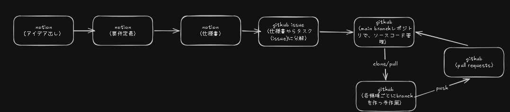
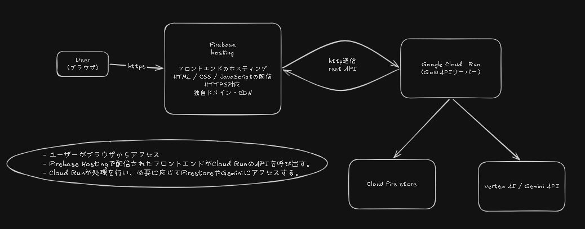
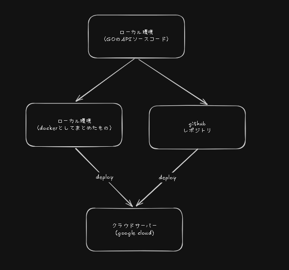

# プロジェクトの理解

## 開発環境
- notion
  - 要件定義、
  - アイデア出し、
  - 予定管理、
  - 議事録、
  - ドキュメント管理
- github
  - repository：ソースコード管理
  - Issue：TODO,バグ管理
  - Pull Requests：コード提案

### 開発環境のフロー

## スタックフロー

## GoAPIとgoogle cloudのフロー

## 技術選定（ADR)

### front end
- 使用言語：React, Vite, TypeScript , JavaScritp
- ホスティングサービス：firebase hosting

#### ReactのPros

- 画面を部品単位に分けられる
- 複数画面の状態を管理しやすい
- 対話型UIと相性がよい
- コンポーネントを再利用できる
- 利用者や情報が多い

#### TypeScriptのPros

- APIのデータ形式を明示できる
- 型の間違いを実行前に発見しやすい
- 会話履歴や振り返りの構造を安全に扱える
- 大きくなったときに保守しやすい

#### ViteのPros

- 開発サーバーの起動が速い
- 変更をすぐブラウザで確認できる
- Reactアプリのビルドが簡単
- SSR不要の静的サイトに向いている

#### Firebase HostingのPros

- 静的ファイルを簡単に公開できる
- CDNによって配信できる
- Cloud RunのAPIと分離できる
- 画面とバックエンドを別々に更新できる
- Google Cloudとの相性がよい

#### ReactのCons

- HTMLとJavaScriptだけより学習量が増える
- コンポーネント設計が必要になる
- 状態管理が複雑になる可能性がある
- 小規模な画面では大きな構成になることがある

#### TypeScriptのCons

- JavaScriptに加えて型の学習が必要
- 型定義を書く分、コード量が増える
- 型だけでは実行時の不正データを防げない
- APIレスポンスの検証処理も別途必要

#### ViteのCons

- Vite自体は画面機能を提供しない
- ビルド設定や環境変数の理解が必要
- SSRや複雑なサーバー処理には別の構成が必要

#### Firebase HostingのCons

- Geminiを呼び出す処理はできない
- APIキーなどの秘密情報を置けない
- 動的なバックエンド処理にはCloud Runなどが必要
- フロントエンドとバックエンドを別々に管理する必要がある
- APIのURLやCORS設定を別途管理する必要がある

### backend 
- 使用言語：Go
- ホスティングサービス：google cloud

#### Pros（利点）
- チーム内の既存知識を活用できた
- HTTP APIサーバーとして実装できた
- Cloud Run上でコンテナとして動かせた
- 型付きでリクエストやレスポンスを扱えた

#### Cons / Risks（欠点・リスク）
- Goを使えるメンバーに知識が偏る可能性がある
- フロントエンドのTypeScriptとは別言語になる
- PythonやNode.jsと比較した開発速度・AI連携の優位性は検証できていない
- 開発前に十分な技術比較をしていなかった

#### Alternatives（代替案）
- Python：AI関連ライブラリや情報量が多い
- Node.js / TypeScript：フロントエンドと同じ言語系統にできる
- PHP：Webバックエンドの代表的な選択肢

